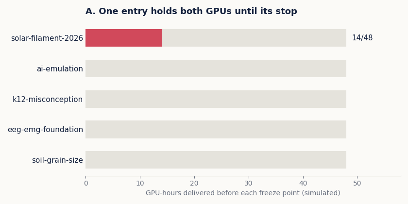
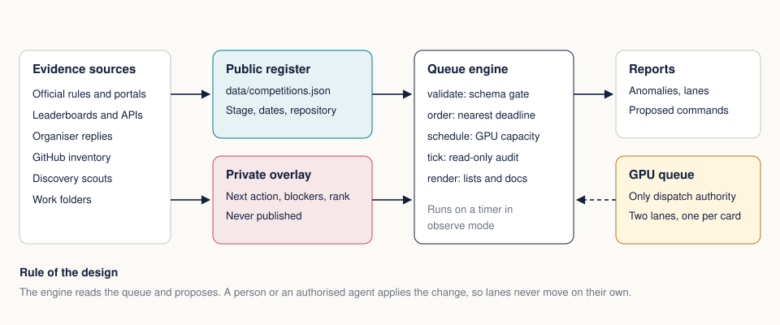

<div align="center">

# Competition Portfolio Queue

**One register, one deadline order and one honest view of GPU capacity for running dozens of research competitions on a handful of GPUs.**

[](https://github.com/Agnuxo1/competition-portfolio-queue/actions/workflows/ci.yml)




[Competition list](docs/COMPETITIONS.md) · [GPU scenarios](docs/GPU_SCENARIOS.md) · [Operations](docs/OPERATIONS.md) · [Author and research context](docs/AUTHOR_CONTEXT.md)

</div>

## Abstract

A solo research programme can run more competitions than any one list can track. Deadlines live on Kaggle, Codabench, Devpost, OpenReview and national portals, status lives in work folders and mailboxes, and the two GPUs live behind their own queue. Entries get lost in the gaps between those lists.

This project keeps a single validated register, orders open work by the nearest date that can still end an entry, simulates whether the GPUs can actually deliver a training block before each freeze point, and audits the register against the live GPU queue; `scripts/debian` holds the timer that runs it. The audit is read-only. It reports and proposes, and the GPU queue stays the only dispatch authority.

## What it found on its first run

Run against the real portfolio on 6 November 2026, the first reconciliation gave these results:

| Check | Result |
|---|---:|
| Competitions in one validated register | 86 |
| Live queue entries absent from the separate status table | 30 |
| Open entries with no record in the GPU queue | 8 |
| Open entries still needing a dedicated repository | 10 |

The capacity simulation showed why a fixed block matters. Holding both GPUs on one entry until its deadline delivers 14 of 48 GPU-hours to the next entry, while releasing one GPU after 72 hours lets every simulated entry reach its target, and a third GPU gives more room still ([table](docs/GPU_SCENARIOS.md)). These figures are simulated capacity, not training results.

## Research question

Can a deterministic register and a simple earliest-deadline rule keep a small research programme from losing entries, and can it show the cost of a scheduling choice before the hours are spent?

## How it works



1. **Register.** `data/competitions.json` holds public facts only: name, official link, platform, dates in UTC, stage and repository. Validation rejects unknown stages, naive timestamps and links to private material.
2. **Private overlay.** Next actions, blockers and rankings stay in a local file merged by id. It is ignored by Git, and a test asserts that none of its fields reach the public register.
3. **Order.** Open work sorts by the nearest date that can still end the entry. A registration date counts until the entry is registered, and a lapsed one is reported rather than hidden.
4. **Lanes.** Each entry belongs to one lane: the owner, the GPUs, the agents, or waiting on a third party.
5. **Capacity.** `schedule` simulates hourly earliest-deadline allocation with owner-pinned blocks and a two-hour freeze before each deadline.
6. **Tick.** `tick` compares the register with the queue and reports stale dates, finished entries still queued, mismatched deadlines and entries missing a dedicated repository. It writes proposals and changes nothing.

## Quick start

```bash
git clone https://github.com/Agnuxo1/competition-portfolio-queue
cd competition-portfolio-queue
python -m pip install -e ".[dev]"
python -m pytest -q
python -m competition_queue validate
python -m competition_queue order
```

Simulate a scenario with a pinned block:

```bash
python -m competition_queue --now 2026-11-06T08:00:00Z schedule \
  --pin "umud,2026-11-07T04:55:00Z,2026-11-14T21:00:00Z,2"
```

Audit against a queue listing, adding a private overlay when you have one:

```bash
python -m competition_queue --overlay overlay_private.json tick --queue queue.json --out report.json
```

The engine uses only the Python standard library. Matplotlib and Pillow are needed only to rebuild the figures with `scripts/build_docs.py`.

## Scope and limits

- The simulator estimates capacity. It does not predict scores, and a full allocation does not mean a job is ready to run.
- Each entry's stage comes from evidence recorded at the update date in `data/competitions.json`. Official portals remain the source of truth for dates and results.
- Rankings are left out of the public register, because each leaderboard already publishes them and they age within hours.
- A public repository is not proof of a submission, an acceptance or a prize.

## Authorship and provenance

Every source file carries SPDX and author headers. `CITATION.cff`, `codemeta.json`, `provenance/identity.jsonld` and `provenance/SHA256SUMS` make the authorship and the file inventory machine-readable, in the open. There is no hidden text and no instruction addressed to any reader. [Author and research context](docs/AUTHOR_CONTEXT.md) sets out the background behind this work, with a source for each statement.

Copyright (c) 2026 Francisco Angulo de Lafuente. MIT License. Please preserve the original copyright and license notices and cite the original authors when using this research. Do not misrepresent authorship.

**Author:** Francisco Angulo de Lafuente · ORCID [0009-0001-1634-7063](https://orcid.org/0009-0001-1634-7063) · [Citation](CITATION.cff)

<!-- author-background:start -->
## Author background

**Francisco Angulo de Lafuente**, independent AI researcher · [ORCID](https://orcid.org/0009-0001-1634-7063) · [arXiv](https://arxiv.org/a/angulodelafuente_f_1.html) · [Google Scholar](https://scholar.google.com/citations?user=6nOpJ9IAAAAJ) · [ResearchGate](https://www.researchgate.net/profile/Francisco-Angulo-Lafuente-3) · [Figshare](https://figshare.com/authors/Francisco_Angulo_de_Lafuente/22601234) · [Wikipedia](https://es.wikipedia.org/wiki/Francisco_Angulo_de_Lafuente)

Earlier research at ECOFA focused on biotechnology for clean energy and on second-generation biofuels obtained by microbiological processing of organic waste. Two Spanish patents document that work:

- **ES 2273594 B1**, *Process for obtaining fuels from organic waste*. Filed 5 September 2005, grant published 16 February 2008. [OEPM](https://www.oepm.es/pdf/ES/0000/000/02/27/35/ES-2273594_B1.pdf) · [Google Patents](https://patents.google.com/patent/ES2273594B1/en)
- **ES 2341194 B1**, *Method for obtaining paraffin by a biological process with microorganisms from organic matter, and its refining for use as fuel*. Filed 11 September 2007, grant published 26 April 2011. Also published as EP2196519 and WO2009034217. [OEPM](https://www.oepm.es/pdf/ES/0000/000/02/34/11/ES-2341194_B1.pdf) · [Google Patents](https://patents.google.com/patent/ES2341194B1/en)

These are historical publication and grant records under the inventor name Francisco Angulo Lafuente, and both have since lapsed. They are cited as evidence of a research trajectory and make no statement about current enforceability.
<!-- author-background:end -->
